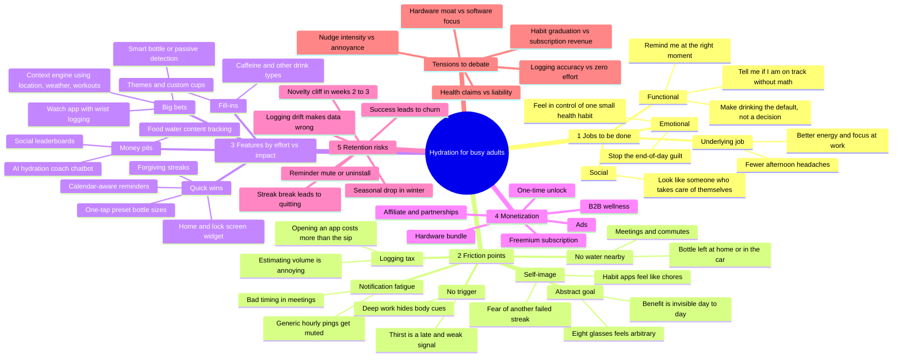

# Discovery Sprint Brainstorm: Water-Tracking App for Busy Adults

**Target user:** Adults aged 25–40 who know they should drink more water but forget. The gap is between what they intend and what they do, not a lack of knowledge.
**Purpose:** A starting map for discovery-sprint debate. Every item here is a **hypothesis to validate**, not a decision.
**Legend:** ⚡ = strategic tension the team should debate on purpose

---

## 1. Visual mindmap



---

## 2. Branch details

### Branch 1: Core jobs-to-be-done

> **Primary JTBD:** *"When I'm busy with work and life, help me drink enough water without having to think about it, so I feel sharper and stop feeling guilty about neglecting a basic habit."*

| Type | Job | Implication for product |
|---|---|---|
| Functional | Remind me at a moment when I can actually drink | Reminder *timing* matters more than reminder *count* |
| Functional | Make drinking automatic, not a decision | Design for habit cues (after coffee, after meetings), not willpower |
| Functional | Tell me if I'm on track at a glance | Show progress somewhere ambient (widget, watch), not inside the app |
| Emotional | Feel in control of one small, doable health habit | Easy early wins; avoid shame |
| Emotional | Stop the 9 p.m. "I only had one glass" guilt | Nudges that help you catch up mid-day, not a report at night |
| Social | Signal "I take care of myself" | Optional sharing; a nice-looking bottle or widget is part of the identity |
| Underlying | Energy, focus, fewer headaches, skin | **Hydration is a means, not the goal.** Messaging should sell how users feel, not millilitres |

⚡ **Tension: Is the job "track water" or "feel better"?** If it's "feel better," the app should connect hydration to outcomes like energy and focus. That's a stronger value proposition, but it pushes us toward health claims (see Branch 4 and the tensions table).

**Discovery questions:** Which outcome do users actually care about? What moments do they already drink in, such as coffee or the gym? Have they tried tracking apps before, and why did they stop?

---

### Branch 2: Friction points in existing behavior

| Friction | Root cause | Severity (hypothesis) | Possible lever |
|---|---|---|---|
| No trigger to drink | Thirst is a weak, late signal; focus work hides it | **High** | Context-aware cues |
| Water not within reach | Bottle forgotten; meetings, commutes | **High** | Habit anchoring ("refill when you get coffee"), bottle reminders when leaving home |
| Logging takes more effort than drinking | Unlock phone → open app → pick amount | **High** | Widget, watch, one tap, passive detection |
| Notification fatigue | Generic, fixed-interval pings | **High** | Adaptive timing, calendar awareness, fewer but smarter nudges |
| Goal feels arbitrary | "8 glasses" has no personal meaning | Medium | Personalized goal with a simple explanation |
| Benefits are invisible | No immediate feedback loop | Medium | Self-reported energy check-ins, trend correlations |
| Habit-app fatigue / shame | History of broken streaks | Medium | Forgiving mechanics, no guilt copy |

**Key insight to test:** The main friction is probably **logging and timing, not motivation**. If that's true, the product should lean on reducing effort, not on gamification.

⚡ **Tension: Do we solve drinking or logging?** Users don't need to log to get hydrated. A product that perfectly reduces logging friction may still not change behavior. And a product that changes behavior (better cues, bottle habits) may need very little logging at all.

---

### Branch 3: Feature ideas ranked by effort vs. impact

```
                 LOW EFFORT                    HIGH EFFORT
           ┌──────────────────────────┬──────────────────────────┐
  HIGH     │  QUICK WINS  (build now) │  BIG BETS  (validate 1st)│
  IMPACT   │  • Home/lock widget      │  • Watch app + wrist log │
           │  • One-tap preset sizes  │  • Context engine        │
           │  • Calendar-aware nudges │    (location, weather,   │
           │  • Forgiving streaks     │     workouts, calendar)  │
           │  • Habit anchors         │  • Smart bottle / passive│
           │    ("after coffee")      │    detection             │
           ├──────────────────────────┼──────────────────────────┤
  LOW      │  FILL-INS  (if cheap)    │  MONEY PITS  (avoid)     │
  IMPACT   │  • Themes, custom cups   │  • Social leaderboards   │
           │  • Caffeine/other drinks │  • AI chat "coach"       │
           │  • Export data           │  • Food water tracking   │
           └──────────────────────────┴──────────────────────────┘
```

| Rank | Feature | Effort | Impact | Why |
|---|---|---|---|---|
| 1 | Home / lock-screen widget with one-tap log | S | High | Removes the "open app" step; progress is always visible |
| 2 | Calendar-aware smart reminders | M | High | Targets the #1 cause of churn (bad pings) directly |
| 3 | Habit anchors ("remind me after my first coffee") | S | High | Behavior-science approach; triggers based on existing routines |
| 4 | Forgiving streaks (freeze days, "4 of 7 days" goals) | S | Med–High | Protects against "streak broke, I quit" |
| 5 | Apple Health / Google Fit sync | S–M | Medium | Expected by users; lets other apps build on our data |
| 6 | Watch app with wrist logging and haptic nudges | L | High | Lowest-effort way to log; good for meetings |
| 7 | Context engine (weather, workouts, location) | L | Med–High | Personalization users notice, but complex and battery-heavy |
| 8 | Smart bottle / passive detection | XL | High (if it works) | Removes logging entirely; hardware risk |
| — | Social leaderboards | M | Low for this segment | Busy adults rarely want to compete on water; possible later through B2B |
| — | AI coach chatbot | M–L | Low | Adds talking for a user who wants *less* interaction |

⚡ **Tension: Personalization depth vs. time-to-value.** A context engine needs permissions (calendar, location) and data before it's useful. Asking for these at onboarding hurts activation; asking later means a generic first week, which is exactly when churn happens.

---

### Branch 4: Monetization paths with tradeoffs

| Path | How it works | Pros | Cons / risks | Fit |
|---|---|---|---|---|
| **Freemium subscription** | Free core tracking; paid smart reminders, insights, watch | Recurring revenue; standard in the category | Low willingness to pay for "water"; many free competitors; puts the best features behind a paywall | ★★★ |
| **One-time unlock** | Pay once for premium | Low friction; honest; matches a "habit then graduate" model | No recurring revenue; hard to fund ongoing work | ★★ |
| **Hardware bundle** | Smart bottle plus app | Physical moat; higher price; passive logging | Inventory, hardware support, high capital needs; distracts a startup | ★★ (later) |
| **B2B / corporate wellness** | Sold to employers as part of wellness programs | The buyer isn't the user, so pricing isn't limited by consumer willingness to pay; matches the 25–40 office-worker segment | Long sales cycles; employee privacy concerns; needs team features | ★★★ (validate) |
| **Ads** | Free app with ads | Easy to start | Ruins a calm, low-friction experience; privacy problems with health data | ★ |
| **Affiliate / partnerships** | Bottle, electrolyte, and wellness brand deals | Revenue that fits the product | Can look like selling the user; weakens trust | ★★ |
| **Insurer / payer** | Hydration as part of a preventive health bundle | Large contracts | Needs clinical evidence; regulatory burden; very long timeline | ★ (long-term) |

⚡ **Tension: Subscription revenue vs. "habit graduation."** If the app works, the habit becomes automatic and users don't need us anymore. A subscription model then pushes us to create dependence, such as more notifications, streak pressure, and engagement tricks, which goes against the user's actual job. **Debate:** Do we design for graduation (one-time price, B2B, or bundling into a wider wellness product) or for ongoing engagement (expand into a broader "daily basics" habit app: water → movement → sleep)?

⚡ **Tension: B2C vs. B2B focus.** B2B solves willingness to pay but changes the roadmap toward admin dashboards, team challenges, and compliance. Trying to serve both at seed stage risks doing neither well.

---

### Branch 5: Retention risks and mitigations

| Risk | Signal to watch | Mitigation |
|---|---|---|
| **Novelty cliff** (weeks 2–3) | D7 → D30 drop-off | Move the value outside the app (widget/watch) so it doesn't depend on opening it; vary the nudges; a "you've built the habit" milestone |
| **Reminders muted or app uninstalled** | Notification opt-out rate, uninstall after a ping | Adaptive frequency (back off when ignored), calendar awareness, user-tunable "nudge personality" |
| **Streak break → quit** | Churn within 48h of a broken streak | Freeze days, weekly rather than daily goals, "welcome back" copy instead of a reset counter |
| **Success churn** (habit formed, app no longer needed) | Users with steady goal completion stop logging | Maintenance mode (check-in once a week); expand into adjacent habits; let them leave on good terms |
| **Logging drift** (still drinking, stopped logging) | Logs/day falls but the app is still opened | Accept rough estimates ("about the same as yesterday?"); passive inputs |
| **Seasonal drop** | Engagement falls in winter | Seasonal goals; switch focus to warm drinks or tea; winter-specific prompts |
| **Value not felt** | Low scores on "is this helping?" | Weekly energy/focus self-check correlated with intake ("on 2L days you rated focus 20% higher") |

⚡ **Tension: Is churn after habit formation a failure?** Standard retention metrics (D30, DAU/MAU) may treat our *best* outcome as a loss. The team needs to agree on whether the north-star metric is **engagement** or **habit outcomes** (e.g., % of users meeting their goal 5+ days/week at week 8, whether or not they log daily).

---

## 3. Strategic tensions summary (for sprint debate)

| # | Tension | Side A | Side B | What would resolve it |
|---|---|---|---|---|
| 1 | **Accuracy vs. effort** | Precise logging gives trustworthy insights and premium value | Rough or passive logging keeps people using it | Test whether "rough" logging users retain better and still feel the benefit |
| 2 | **Graduation vs. subscription** | Help users build the habit and leave happy | Recurring revenue requires ongoing engagement | Willingness-to-pay interviews; check whether expanding to adjacent habits is credible |
| 3 | **Nudge intensity vs. annoyance** | More reminders → more drinking | More reminders → mute/uninstall | A/B test reminder frequency against both intake and opt-out rate |
| 4 | **Hardware moat vs. software focus** | Smart bottle makes logging effortless and is defensible | Hardware drains capital and focus | Partner or integrate with existing bottles before building our own |
| 5 | **Outcome claims vs. liability** | "Feel more focused" is the real value prop | Health claims create regulatory and legal exposure, plus overhydration risk for some medical conditions | Legal review; wellness-only language; clear safety guardrails |
| 6 | **B2C vs. B2B** | Consumer brand, fast iteration | Employers pay; better fit for the segment | Run a small number of employer pilots alongside the consumer MVP |
| 7 | **Personalization vs. time-to-value** | Context engine = better nudges | Permissions and setup hurt activation | Progressive permission requests; measure activation at each step |

---

## 4. Suggested sprint focus

1. **Validate the riskiest assumption first:** *"Busy adults forget because of missing triggers and logging friction, not low motivation."* (Interviews and a diary study.)
2. **Prototype the quick wins** (widget, habit anchors, calendar-aware nudge) and test whether intake changes, not just whether people log.
3. **Run willingness-to-pay and B2B interviews in parallel** to decide tensions #2 and #6 before roadmap lock.
4. **Agree on the north-star metric** (engagement vs. habit outcome) before building analytics.

> ⚠️ All items above are brainstorm hypotheses and need validation with real users and human review before driving roadmap decisions. Any health or wellness claims should get legal/compliance review before use in product copy.
