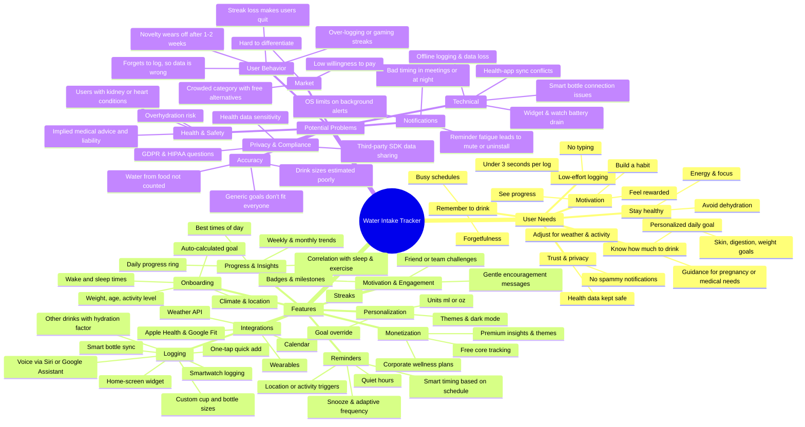

# Mindmap: Daily Water Intake Tracker (Mobile App)

---

## How to read this

| Branch | PM takeaway |
|---|---|
| **User Needs** | The core job is *"help me remember and make it effortless."* Logging speed and good reminders matter more than detailed analytics. |
| **Features** | MVP = onboarding + personalized goal, one-tap logging and widget, smart reminders, daily progress ring, streaks. Integrations, challenges, and premium come later. |
| **Potential Problems** | The biggest risk is **retention**: novelty fades and reminders get muted. Address it from day one with adaptive reminders, forgiving streaks (e.g., "freeze" days), and logging that takes almost no effort. |

## Suggested MVP vs. Later

- **MVP (v1):** Onboarding & goal calculation, quick-add buttons, home-screen widget, smart reminders with quiet hours, daily ring + 7-day history, streaks, Apple Health / Google Fit sync.
- **v2:** Weather-adjusted goals, smartwatch app, other drink types, badges, deeper insights.
- **v3:** Social challenges, smart bottle integrations, premium tier, corporate wellness.

## Key metrics to watch

- **Day-7 / Day-30 retention**: the main signal of habit formation
- **Logs per active user per day**: shows engagement and data quality
- **% of days goal achieved**: shows the value delivered
- **Notification opt-out rate**: early warning for reminder fatigue
